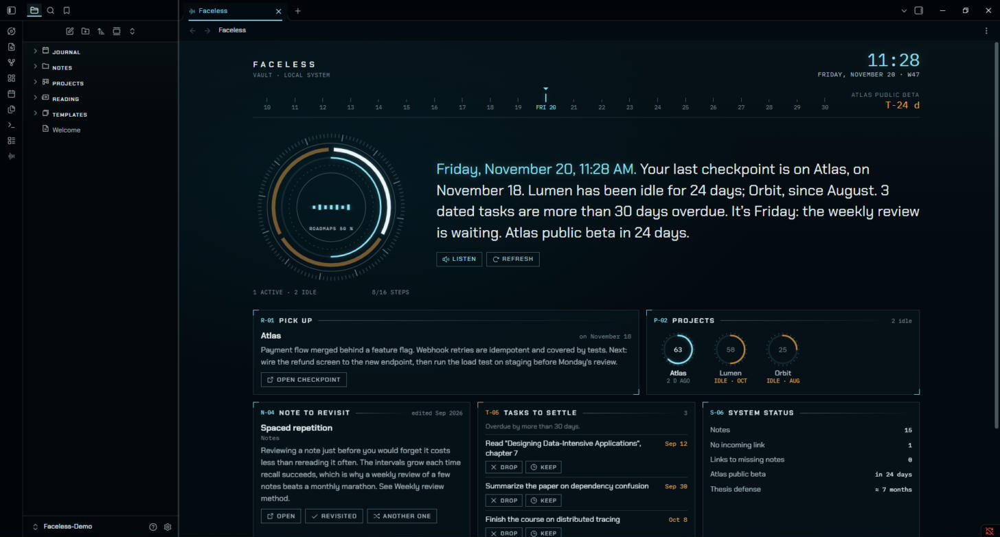

# Faceless

A home page for Obsidian in the style of a sci-fi HUD, with a voice and no face.

It opens in its own tab and tells you, in one short paragraph built from your vault, what matters today: where you left off, which projects have gone idle, which dated tasks are long overdue, what deadline is next. Press **Listen** and it reads it aloud with your system voice.

The interface follows Obsidian's language: **English or French**.



## What is on the page

- **The voice paragraph.** Plain facts computed locally from your notes. No AI, no network.
- **The reactor.** Concentric rings: one segment per project (white when active, amber when idle), the overall progress of your roadmaps, and a waveform in the middle that moves with the voice.
- **Heading tape.** Three weeks with today in the middle; dated tasks and deadlines are marked on it. The next deadline is shown as a countdown.
- **Pick up.** For each project, the first heading of its hub that matches your checkpoint pattern (by default "Point de reprise", "Checkpoint" or "Where I left off") and the paragraph under it.
- **Projects.** One gauge per subfolder of your projects folder: roadmap progress (checked / total tasks in a note whose name contains "roadmap") and last activity. A project with no edited note for 14 days is marked idle.
- **Note to revisit.** One older note per day, picked at random but weighted towards notes linked to your active projects. Mark it as revisited or draw another one.
- **Tasks to settle.** Tasks whose 📅 due date is more than 30 days past. **Drop** marks the task as cancelled (`- [-] … ❌ date`, the Tasks plugin format); **Keep** hides it for 30 days.
- **System status.** Note count, notes with no incoming link, links to missing notes, and optionally the size of an instructions file against its cap.
- **Weekly review.** On the day you choose (Friday by default), a button creates a note with seven fixed questions, one to three sentences each.
- **Ask the vault** *(only if the Claudian (by [YishenTu](https://github.com/YishenTu)) plugin is installed)*. Types your question into Claudian with an instruction to answer from your notes.
- **Phosphor icons in the file explorer**, chosen from folder names and the `type:` property, with a right-click menu to pick any icon and color.
- **Optional theme** across Obsidian (sidebar, tabs, headings, status bar) in the same colors, and an optional skin for Claudian. Both can be turned off.

## Getting started

1. Enable the plugin. Faceless guesses your projects folder (a top-level folder whose name contains "project" / "projet") and your journal folder ("journal", "daily"). Check them in **Settings → Faceless**.
2. Optional: add deadlines (`Final exam | 2027-03`, `Thesis defense | 2027-06-14`), shortcuts to notes, and the checkpoint heading you use in your project hubs.
3. Run **Faceless: Open home** or click the waveform icon in the ribbon.

## Voice

**Listen** reads the paragraph with your system's text-to-speech voice, in the interface language. While it speaks, the waveform in the reactor moves.

## Disclosures

- **Network use:** none.
- **Files outside the vault:** none. Faceless does not use Node.js file or process APIs.
- **Files inside the vault:** Faceless reads your notes through Obsidian's API to build the page (it lists every note to count them, find notes with no incoming link and pick a note to revisit). It writes only when you click: a weekly review note when you start the review, and a task line when you click **Drop**.
- **Clipboard, local storage, telemetry, ads, accounts:** none.
- The file explorer icons rely on an undocumented part of Obsidian's file explorer; a future Obsidian update could break them without affecting the rest of the plugin.
- The Claudian integration is optional and only active when Claudian is installed: it types your question into Claudian's input.

Desktop only.

## Building

```bash
npm install
npm run build   # writes dist/main.js, dist/styles.css, dist/manifest.json
```

License: MIT. Bundled fonts and icons: see [THIRD_PARTY_NOTICES.md](THIRD_PARTY_NOTICES.md).

---

## Français

Page d'accueil façon HUD de science-fiction, qui parle : où tu t'es arrêté, les projets en veille, une note à relire, les tâches très en retard à trancher, les échéances, la revue de la semaine. L'interface suit la langue d'Obsidian (français ou anglais). Lecture à voix haute avec la voix du système. Aucune requête réseau, aucun accès hors du vault, aucune télémétrie.
